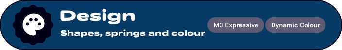

# SOMNIA

**Sleep tracking, rethought for Android.**

A modern sleep companion built with Kotlin and Jetpack Compose.

 

---

## About

Somnia is an Android sleep-tracking application focused on making sleep information easier to understand.

Built with Kotlin and Jetpack Compose, the project combines a modern Android interface with a clean visual identity inspired by Material 3 Expressive.

The idea behind Somnia is straightforward: give users a simple place to manage their sleep sessions, look back at their sleeping patterns and understand their rest.

## Features

Somnia is being developed around several core features.

| Sleep sessions | Sleep history |
|:---:|:---:|
| Start and stop sleep sessions manually, with a live session duration. | Keep a record of previous sessions and revisit sleeping patterns. |
| **Sleep insights** | **Personalisation** |
| View sleep durations through visual summaries and charts. | Adjust the app's appearance with theme options, including dark and AMOLED-friendly styling. |

Additional functionality and improvements are planned as development continues.

*Note: Features are subject to development and may not all be available in the current version.*

## Design

Somnia follows an Android-first design direction, taking inspiration from Google's Material 3 Expressive design language.

Some of its design choices include:

- Material 3 Expressive components.
- Google Sans Flex Rounded typography.
- Material Symbols Rounded icons.
- Deep blue and dark surface colours.
- A floating pill-style navigation bar.
- Carefully considered spacing and component sizing.
- Smooth transitions and interactive elements.

The aim is to create an interface that feels familiar on Android while still giving Somnia its own identity.

## Screenshots

## Built with

Somnia uses a modern Android development stack.

| Technology | Purpose |
|---|---|
| Kotlin | Main programming language |
| Jetpack Compose | UI development |
| Material 3 Expressive | Design system |
| Room | Local database |
| Kotlin Coroutines | Asynchronous operations |
| Kotlin Flow | Reactive data streams |
| Navigation Compose | Screen navigation |
| KSP | Kotlin Symbol Processing |

## Project information

| Detail | Value |
|---|---|
| Project | Somnia |
| Package name | `com.lowestm3e.somnia` |
| Current version | `0.1.12.1` |
| Minimum Android version | Android 12 (API 31) |
| Target SDK | 37 |
| Language | Kotlin |
| Platform | Android |

## Development

Somnia is an ongoing project. Its interface and underlying functionality are continuously being developed and improved.

Future development may include:

- More detailed sleep insights.
- Improved session management.
- Additional visualisations.
- Further personalisation options.
- Improvements to performance and stability.

## Source code

Somnia is developed openly on GitHub.

Explore the repository, follow development and take a look at the code behind the application.

[View the Somnia repository](https://github.com/Lowestm3e/Somnia)

## Made with

Somnia has been developed with assistance from **ChatGPT** and **Claude**.

Both AI tools have contributed to the development process through coding assistance, debugging, design discussions, problem-solving and documentation.

The project direction, implementation decisions and final changes are reviewed throughout development.

## Free to edit

You're welcome to explore the project and make modifications in accordance with its licence.

Please review the repository's licence before redistributing or publishing modified versions.

---

**SOMNIA**

*Made for better rest.*

